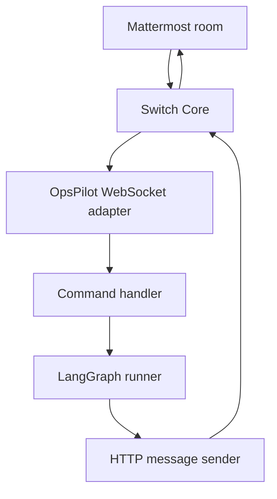

# OpsPilot — AI Engineering Operations Team

OpsPilot is a Python + LangGraph incident assistant for the WeMakeDevs **Flip the Switch** hackathon. It investigates ApplicationOps and DataOps incidents using synthetic operational fixtures, correlates evidence, asks for human approval, and runs **simulated** recovery only after approval.

Specialist agents (log, deployment, health, pipeline, SQL, root cause, recovery) are **internal LangGraph nodes**. Switch sees one external agent: `opspilot`.

## Architecture



## Prerequisites

- Python 3.12
- Local Switch Console / Switch Core (tested against Core **0.31.0** protocol sources)
- Mattermost room with the OpsPilot agent added (e.g. `opspilot-operations`)

## Setup

```powershell
cd D:\Samyak\Projects\opspilot
python -m venv .venv
.\.venv\Scripts\Activate.ps1
pip install -r requirements.txt
copy .env.example .env
```

Fill in `.env` after registration (see below). Never commit `.env`.

## Local demo (no Switch)

```powershell
.\.venv\Scripts\python.exe scripts\run_demo.py
.\.venv\Scripts\python.exe -m opspilot.main
```

## Register the Switch agent

1. Create a **registration** or **bootstrap** API key in Switch Console (or use `SWITCH_GATEWAY_SESSION` for gateway mode).
2. Run:

```powershell
$env:SWITCH_REGISTRATION_TOKEN = "<your-registration-key>"
.\.venv\Scripts\python.exe scripts\register_switch_agent.py
```

3. Copy `SWITCH_AGENT_ID` and `SWITCH_API_KEY` into `.env`.
4. Add the agent to your Mattermost room in Switch Console and set `SWITCH_ROOM_ID` to that room's Switch id.

Protocol details: [docs/SWITCH_PROTOCOL.md](docs/SWITCH_PROTOCOL.md). Gateway registration uses `{SWITCH_GATEWAY_URL}/gateway/agents/register-other` (Core 0.31.0 mounts the gateway at `/gateway`).

## Run with Switch / Mattermost

```powershell
.\.venv\Scripts\python.exe scripts\run_switch_agent.py
```

In Mattermost (`opspilot-operations`):

**ApplicationOps**

```
@opspilot Our checkout API is returning HTTP 500 errors after the latest production deployment.
```

OpsPilot streams triage, specialist summaries, root cause, and:

```
approve INC-1001
```

**DataOps**

```
@opspilot Our Databricks customer analytics pipeline failed because of a SQL schema mismatch.
```

**Other commands**

```
status INC-1001
reject INC-1001
help
```

Recovery is **simulated** (runtime state file + verification). It is not a real production rollback or pipeline change.

## Tests

```powershell
.\.venv\Scripts\python.exe -m unittest discover -s tests -t . -v
```

Switch tests mock the network; a live Switch server is not required for CI.

## Troubleshooting

| Symptom | Check |
|---------|--------|
| `Missing Switch configuration` | `.env` has `SWITCH_AGENT_ID`, `SWITCH_API_KEY`, `SWITCH_ROOM_ID` |
| WebSocket `refused` | Agent id/key, room membership, and `connection_id` file |
| No messages received | Message must address OpsPilot; room id must match allowlist |
| Approval ignored | Use exact form `approve INC-1001`, not free-text |
| Thread replies | Core 0.31.0 HTTP send API has no `thread_id`; replies go to the room with incident id in text |

## Project layout

- `opspilot/orchestrator/` — LangGraph workflow and runner
- `opspilot/switch_integration/` — Switch adapter (WebSocket in, HTTP out)
- `data/` — synthetic logs, deployments, metrics, pipeline fixtures
- `scripts/run_switch_agent.py` — Switch runtime entry point
