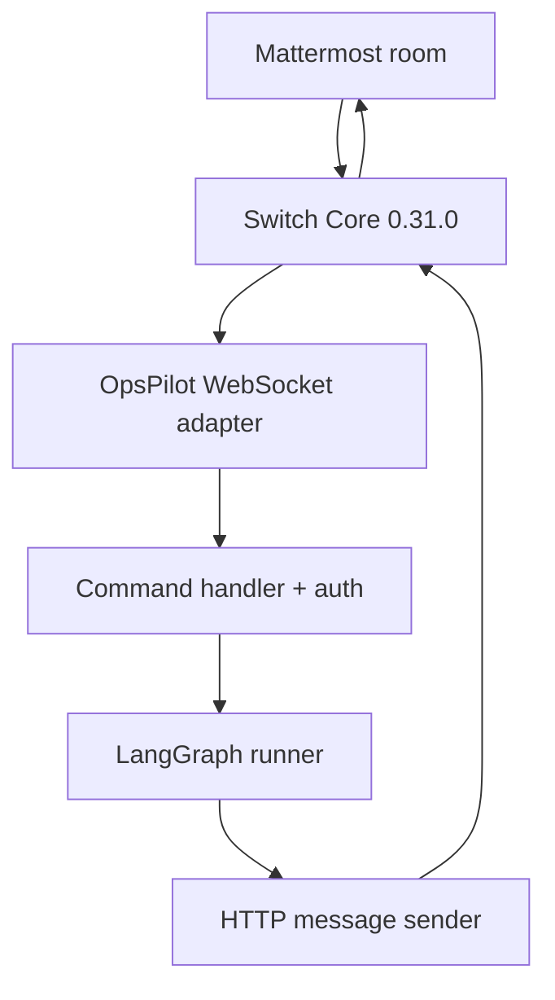

# OpsPilot — AI Engineering Operations Team

OpsPilot is a Python + LangGraph incident assistant for the WeMakeDevs **Flip the Switch** hackathon. It investigates ApplicationOps and DataOps incidents using synthetic operational fixtures, correlates evidence, asks for human approval, and runs **simulated** recovery only after approval.

Specialist agents are internal LangGraph nodes. Switch sees one external agent: `opspilot`.

## Architecture



## Prerequisites

- Python 3.12
- Local Switch Console / Switch Core **0.31.0**
- Mattermost room with OpsPilot added (e.g. `opspilot-operations`)

## Setup

```powershell
cd D:\Samyak\Projects\opspilot
python -m venv .venv
.\.venv\Scripts\Activate.ps1
pip install -r requirements.txt
copy .env.example .env
```

Never commit `.env` or `data/runtime/switch_registration.env`.

## Local demo (no Switch)

```powershell
.\.venv\Scripts\python.exe scripts\run_demo.py
.\.venv\Scripts\python.exe -m opspilot.main
```

## Register the Switch agent

1. In Switch Console, create a **registration** or **bootstrap** API key.
2. Register OpsPilot:

```powershell
$env:SWITCH_REGISTRATION_TOKEN = "<registration-key>"
.\.venv\Scripts\python.exe scripts\register_switch_agent.py
```

3. Credentials are written to `data/runtime/switch_registration.env` (API key is **not** printed).
4. Merge into `.env` when keys are empty:

```powershell
$env:SWITCH_REGISTER_WRITE_ENV = "1"
.\.venv\Scripts\python.exe scripts\register_switch_agent.py
```

Use `SWITCH_REGISTER_FORCE=1` only when you intentionally overwrite existing `.env` values.

5. Add agent `opspilot` to your Mattermost room and set `SWITCH_ROOM_ID` to the Switch room id.

Gateway alternative: `SWITCH_REGISTER_MODE=gateway` with `SWITCH_GATEWAY_SESSION` cookie, endpoint `/gateway/agents/register-other`.

Protocol reference: [docs/SWITCH_PROTOCOL.md](docs/SWITCH_PROTOCOL.md).

## Environment variables

| Variable | Purpose |
|----------|---------|
| `SWITCH_AGENT_BRIDGE_URL` | Agent Bridge base URL |
| `SWITCH_AGENT_ID` / `SWITCH_API_KEY` | External agent credentials |
| `SWITCH_ROOM_ID` or `SWITCH_ROOM_IDS` | Allowed room allowlist |
| `OPSPILOT_APPROVAL_POLICY` | Who may approve/reject (`requester_only` default) |
| `OPSPILOT_APPROVER_SENDERS` | Allowlist of sender ids when policy is `allowlist` |
| `OPSPILOT_APPROVER_ROLES` | Roles allowed when policy is `role_based` |
| `SWITCH_RECONNECT_BASE_SECONDS` / `SWITCH_RECONNECT_MAX_SECONDS` | WebSocket backoff |

## Approval authorization

Default policy **`requester_only`**: only the Mattermost user who opened the incident (same Switch sender id) may run `approve INC-*` or `reject INC-*` in the **same room**.

Other policies:

- **`allowlist`** — requester or ids in `OPSPILOT_APPROVER_SENDERS`
- **`role_based`** — requester or sender role in `OPSPILOT_APPROVER_ROLES`
- **`room_members`** — any addressed human message in the bound room (explicit opt-in)

Decisions are bound to the incident's origin room and serialized in SQLite so duplicate simultaneous approvals cannot resume twice.

## Run the Switch adapter

```powershell
.\.venv\Scripts\python.exe scripts\run_switch_agent.py
```

## Smoke test (live Switch, no incident)

```powershell
.\.venv\Scripts\python.exe scripts\switch_smoke_test.py
```

Checks: Agent Bridge `/health`, credential send, WebSocket `connection_state`. Does **not** start LangGraph investigations.

## Mattermost workflows

Messages must **address OpsPilot** (`@opspilot ...`). Unaddressed messages are ignored.

**ApplicationOps**

```
@opspilot Our checkout API is returning HTTP 500 errors after the latest production deployment.
approve INC-1001
```

**DataOps**

```
@opspilot Our Databricks customer analytics pipeline failed because of a SQL schema mismatch.
approve INC-1002
```

**Safe rejection**

```
reject INC-1001
```

**Status / help**

```
status INC-1001
help
```

Recovery is **simulated** only. Reject never executes recovery.

## Known Switch Core 0.31.0 limitations

- HTTP `POST /agents/{id}/message` does not expose `thread_id`; replies are room messages with incident ids in text.
- WebSocket requires stable `connection_id` and `filter=addressed` for @mentions.

## Tests

```powershell
.\.venv\Scripts\python.exe -m unittest discover -s tests -t . -v
```

Unit tests mock Switch network I/O. Smoke test is separate and optional.

## Troubleshooting

| Symptom | Check |
|---------|--------|
| No response | Message must address OpsPilot; `SWITCH_ROOM_ID` must match |
| Approval refused | Policy, room binding, exact `approve INC-1001` form |
| Cross-room approval | Open and decide in the same room as the incident |
| WebSocket refused | Agent membership, connection id file, credentials |
